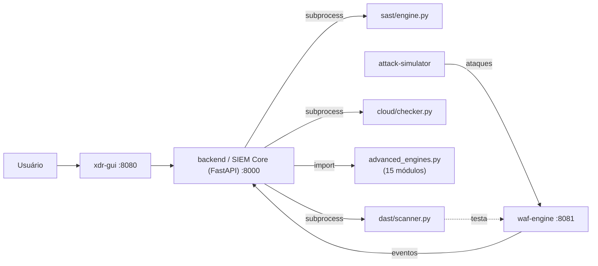

<div align="center">

# 🛡️ XDR Neo-Platform | Enterprise Security Lab

**Plataforma unificada de Extended Detection and Response (XDR) com 18 módulos de detecção, resposta e inteligência cibernética, construída sobre algoritmos reais — não simulações.**


[Visão geral](#-visão-geral) • [Módulos](#-módulos) • [Arquitetura](#-arquitetura) • [Como executar](#-como-executar) • [API](#-api) • [Limitações](#-limitações-conhecidas) • [Autor](#-autor)

</div>

---

## 📌 Visão geral

O **XDR Neo-Platform** é um laboratório de segurança que reúne, em uma única plataforma, **18 módulos** de detecção, resposta e inteligência cibernética. Cada um implementa um algoritmo real — análise estática via AST, pattern matching com regex, entropia de Shannon, Z-score, busca em grafo (DFS), ataque de dicionário — e é exposto através de uma API central que também funciona como SIEM.

**Componentes principais**

- **Frontend:** painel web em HTML/CSS/JS puro.
- **Backend (SIEM Core):** API em `Python + FastAPI` (`main.py`) que ingere eventos, orquestra os módulos e expõe os resultados.
- **Engine de algoritmos:** `advanced_engines.py`, com a implementação de 15 dos 18 módulos (os 3 restantes — SAST, DAST e Cloud — rodam como scripts externos, chamados via `subprocess`).


*A interface é identificada internamente como "XDR CORE". O painel inicial ("Centro de Inteligência de Ameaças") mostra Riscos Críticos, Eventos Lidos, Infrações Intrusivas e Saúde Global em tempo real, além dos logs de rede.*

---

## 🧩 Módulos

Todos os módulos são acionados via `GET /api/v1/run/{module}`.

### 1. Inteligência e análise base

| # | Nome na interface | Módulo (`module`) | Mecanismo |
|---|---|---|---|
| 1 | Analisador Estático (SAST) | `sast` | Executa `sast/engine.py` (análise estática via AST) como processo externo. |
| 2 | Motor Dinâmico (DAST) | `dast` | Executa `dast/scanner.py` contra o alvo (padrão: `waf-engine:8081`). |
| 3 | Auditoria Cloud/K8s | `cloud` | Executa `cloud/checker.py` para validar manifests Docker/K8s. |
| 4 | Correlação de IOCs | `ioc` | Consulta geolocalização/ASN via **ip-api.com** e verifica o IP contra a blocklist **Spamhaus ZEN** por DNS reverso. |
| 5 | Analista SOC via IA | `ai-soc` | Motor de regras: casa palavras-chave no log (`sqli`, `1=1`, `root`, `buffer`...) e retorna a ação de contenção correspondente. |

### 2. Contramedidas e EDR

| # | Nome na interface | Módulo (`module`) | Mecanismo |
|---|---|---|---|
| 6 | Proteção Avançada RASP | `rasp` | Executa o payload com `exec()` em um `globals` restrito (`__builtins__: None`), bloqueando antes strings como `import`, `eval` e `exec`. |
| 7 | Caçador de Tráfego (Rede) | `network` | Converte um payload hexadecimal em bytes e procura assinaturas de **NOP sled** (heap spraying) e magic bytes de executáveis (`MZ`, `ELF`). |
| 8 | Forense de Memória RAM | `memory` | Aplica regex sobre um dump de texto para encontrar chaves RSA, certificados PEM, chaves AWS (`AKIA...`), JWTs e atribuições de credencial. |
| 9 | <!-- AJUSTAR: nome exibido na UI --> | `dns` | Calcula a **entropia de Shannon** da query (em bits/caractere); acima de 4.3 bits com mais de 25 caracteres, classifica como possível DNS tunneling. |
| 10 | <!-- AJUSTAR: nome exibido na UI --> | `endpoint` | Calcula o **Z-score** de CPU e nº de processos a partir de `cpu,ram,procs`; dispara alerta de ransomware/injeção quando ambos ultrapassam o limiar. |
| 11 | <!-- AJUSTAR: nome exibido na UI --> | `phishing` | Soma uma pontuação de risco com base em palavras-chave (`urgent`, `invoice`, `verify`...) e links não-HTTPS; ≥ 75/100 é classificado como crítico. |

### 3. Ofensiva, forense e criptografia

| # | Nome na interface | Módulo (`module`) | Mecanismo |
|---|---|---|---|
| 12 | <!-- AJUSTAR: nome exibido na UI --> | `bloodhound` | Recebe um grafo JSON (`{"nó": ["vizinhos"]}`) e faz **busca em profundidade (DFS)** até encontrar um caminho até `Domain_Admin`. |
| 13 | <!-- AJUSTAR: nome exibido na UI --> | `crack` | Ataque de dicionário: compara o hash MD5 informado contra uma wordlist fixa (`123456`, `admin`, `password`...). |
| 14 | <!-- AJUSTAR: nome exibido na UI --> | `exploit` | Testa o payload contra assinaturas de XSS, SQL Injection e LFI (`../etc/passwd`), simulando o bloqueio no WAF. |
| 15 | <!-- AJUSTAR: nome exibido na UI --> | `honeypot` | Retorna o tipo de isca configurada para a porta informada (ex.: 22 → SSH tarpit, 3306 → MySQL falso). |
| 16 | <!-- AJUSTAR: nome exibido na UI --> | `darkweb` | Gera o SHA-256 do e-mail informado e compara contra um hash de exemplo fixo no código. |
| 17 | <!-- AJUSTAR: nome exibido na UI --> | `firmware` | Identifica o tipo de arquivo pelos *magic bytes* (`MZ` → PE Windows, `7F454C46` → ELF, `504B0304` → ZIP). |
| 18 | <!-- AJUSTAR: nome exibido na UI --> | `decoder` | Decodificador recursivo: tenta Base64, hexadecimal, URL-encode e binário ASCII em camadas, até 15 iterações, revelando o payload original. |

**Painel Central (SIEM):** não é um módulo numerado — é o próprio backend, que recebe eventos via `POST /api/v1/ingest` e os lista via `GET /api/v1/threats`. Na interface, corresponde ao item "Painel Central (SIEM)" no topo da sidebar.

---

## 🏗️ Arquitetura



| Serviço (compose) | Porta | Papel |
|---|---|---|
| `xdr-gui` | 8080 | Interface web |
| `backend` | 8000 | SIEM Core (`main.py` + `advanced_engines.py`) |
| `waf-engine` | 8081 | WAF, alvo do DAST e do `attack-simulator` |
| `attack-simulator` | — | Gera tráfego de ataque contra o `waf-engine` |
| `sast` | — | `sast/engine.py`, chamado via subprocess pelo backend |
| `dast` | — | `dast/scanner.py`, chamado via subprocess pelo backend |
| `cloud` | — | `cloud/checker.py`, chamado via subprocess pelo backend |

---

## ✅ Pré-requisitos

- [Docker](https://docs.docker.com/get-docker/) 20.10+
- [Docker Compose](https://docs.docker.com/compose/install/) 2.x
- Portas **8000**, **8080** e **8081** livres

---

## 🚀 Como executar

```bash
# 1. Clone o repositório
git clone https://github.com/EriveltonRocha77/-XDR-Platform-Enterprise-Security-Lab-.git

# 2. Acesse a pasta do laboratório
cd "-XDR-Platform-Enterprise-Security-Lab-/landingpage erivelton/sec-analyzers-lab"

# 3. Suba todos os serviços
docker compose up -d --build
```

| Acesso | URL |
|---|---|
| Interface web | http://localhost:8080 |
| API (backend/SIEM) | http://localhost:8000 |
| Documentação interativa (Swagger) | http://localhost:8000/docs |
| WAF Engine | http://localhost:8081 |

**Comandos úteis**

```bash
docker compose ps                       # status dos containers
docker compose logs -f backend          # logs do SIEM Core
docker compose up -d --build backend    # recompilar só um serviço
docker compose down                     # parar e remover os containers
```

---

## 📡 API

| Endpoint | Método | Descrição |
|---|---|---|
| `/api/v1/ingest` | `POST` | Registra um evento no SIEM (corpo livre em JSON). |
| `/api/v1/threats` | `GET` | Lista todos os eventos já indexados, mais recentes primeiro. |
| `/api/v1/run/{module}` | `GET` | Executa um dos 18 módulos. Parâmetro `target` opcional (string). |

**Exemplos**

```bash
# Testar detecção de DNS tunneling
curl "http://localhost:8000/api/v1/run/dns?target=aHR0cHM6Ly9leGFtcGxlLmNvbS9sZWFrZWQtZGF0YQ=="

# Analisar um IP via OSINT/Spamhaus
curl "http://localhost:8000/api/v1/run/ioc?target=1.1.1.1"

# Registrar um evento manual no SIEM
curl -X POST http://localhost:8000/api/v1/ingest \
  -H "Content-Type: application/json" \
  -d '{"engine": "waf-engine", "severity": "HIGH"}'
```

---

## 🛠️ Stack

| Camada | Tecnologias |
|---|---|
| Backend | Python 3.11 (Alpine), FastAPI 0.104, Uvicorn |
| Infraestrutura | Docker, Docker Compose |
| Algoritmos | AST, regex, entropia de Shannon, Z-Score, DFS |
| Frontend | HTML, CSS, JavaScript |

---

## 📁 Estrutura do projeto

```
sec-analyzers-lab/
├── docker-compose.yml
├── backend/
│   ├── Dockerfile           # python:3.11-alpine
│   ├── main.py               # API FastAPI / SIEM Core / orquestrador
│   ├── advanced_engines.py   # 15 dos 18 módulos (dns, bloodhound, crack, etc.)
│   └── requirements.txt
├── waf/            # WAF Engine
├── bot/            # Attack Simulator
├── sast/           # Análise estática
├── dast/           # Scanner dinâmico
├── cloud/          # Auditoria cloud/K8s
└── gui/            # Interface web
```

---

## ⚠️ Limitações conhecidas

Por ser um laboratório educacional, alguns pontos usam atalhos deliberados — ou ainda não finalizados — que **não devem ir para produção sem revisão**:

- **Build do backend**: o `Dockerfile` instala `pyyaml` manualmente, mas não executa `pip install -r requirements.txt` — `fastapi` e `uvicorn` não são instalados nesse passo. Confirme se isso é intencional ou se falta a linha `RUN pip install --no-cache-dir -r requirements.txt`.
- **`darkweb`**: compara contra um único hash fixo no código, não uma base de vazamentos real.
- **`crack`**: usa uma wordlist de 6 senhas; serve para demonstrar o conceito de ataque de dicionário, não para auditoria real.
- **`rasp`**: o sandbox bloqueia por substring (`"import" in code_input`), o que é contornável (ex.: `__import__`). É uma demonstração didática do conceito de RASP, não uma proteção de runtime real.
- **CORS**: `main.py` libera `allow_origins=["*"]`. Adequado para o lab local, mas deve ser restringido antes de qualquer exposição externa.
- **Entradas do `run_module`**: o parâmetro `target` alimenta chamadas de `subprocess`; valide/saneie entradas antes de expor a API fora do ambiente local.

---

## ⚖️ Aviso legal e ético

Este projeto tem **finalidade exclusivamente educacional**. Os módulos ofensivos (`crack`, `exploit`, `bloodhound`, `attack-simulator`) devem ser usados **apenas em ambientes próprios ou com autorização expressa**. O autor não se responsabiliza por uso indevido.

---

## 🗺️ Roadmap

- [ ] Corrigir o `Dockerfile` do backend para instalar `requirements.txt`
- [ ] Substituir a wordlist do `crack` por uma lista configurável
- [ ] Persistência do SIEM em banco de dados (hoje em memória, `time_series_db`)
- [ ] Restringir CORS e validar `target` antes de passar para `subprocess`
- [ ] Testes automatizados e CI com GitHub Actions
- [ ] Integração com MITRE ATT&CK para classificar os alertas

---

## 🤝 Contribuindo

1. Faça um fork do projeto
2. Crie uma branch: `git checkout -b feature/minha-feature`
3. Commit: `git commit -m "feat: minha feature"`
4. Push: `git push origin feature/minha-feature`
5. Abra um Pull Request

---

## 📄 Licença

<!-- AJUSTAR: adicione um arquivo LICENSE e confirme a licença escolhida -->
Distribuído sob a licença MIT. Veja o arquivo `LICENSE` para mais detalhes.

---

## 👨‍💻 Autor

**Erivelton da Rocha Silva**
Estudante de Engenharia de Software e Segurança da Informação

[](https://www.linkedin.com/in/eriveltonrocha18)
[](https://eriveltonrochaportifolio1.pages.dev)
[](https://github.com/EriveltonRocha77)

---

<div align="center">⭐ Se este projeto foi útil, considere deixar uma estrela!</div>
